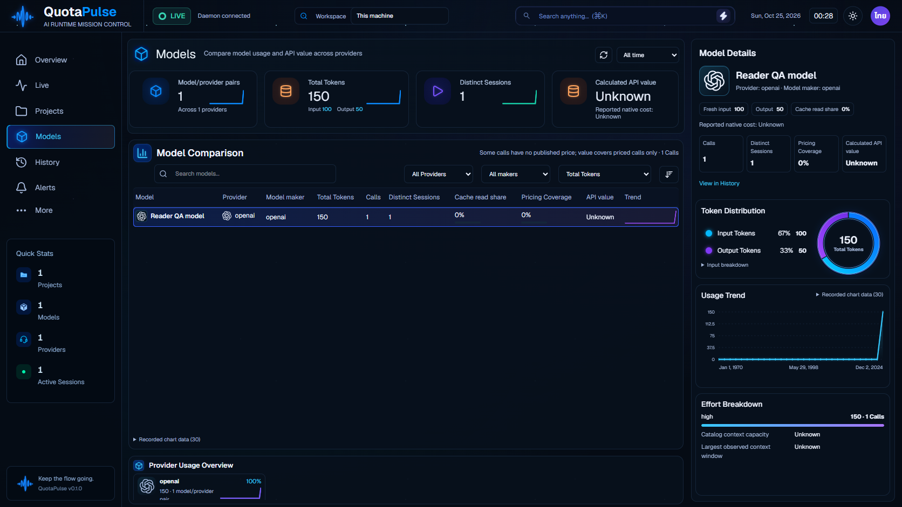

# Portable real-reader opt-in v1.85.137

Validated launcher change. `start-review.ps1 -EnableReaders` explicitly starts the existing local harness/quota readers against the isolated review-data profile. Default launch still disables readers. The switch applies to one launch, overrides inherited QUOTAPULSE_READERS, records the selected mode and allows a nonempty scheduler at readiness. Initial enabled-reader startup has up to300 seconds; default remains30 seconds. Parent environment is restored and scoped stop/ownership guards remain unchanged. Collected review data is retained when restarting without the switch; collection then stops. Existing original application databases are not imported.

Bundle manifest and README explain default/off, opt-in/on and portable-only invocation. Existing installed wrappers do not expose this new switch and were not changed. No daemon, reader, renderer, dependency or database schema changed.

The new executable check uses a fresh fake Windows home, synthetic Codex rollout and original-profile sentinel. Home identity is verified before any reader starts; quota account probes are disabled. Six checks cover both WhatIf modes, default overriding inherited on, explicit mode overriding inherited off, actual Codex ingestion150→190 tokens, API/Models reconciliation, prompt exclusion, repeated refresh, deduplicated restart, retained data when returning to off, and unchanged source/sentinel files. Every launched process is stopped. No customer logs or credentials were read.

The initial test transport hit ECONNRESET after a synchronous process restart. The harness now uses independent HTTP connections for lifecycle assertions rather than retaining pooled sockets across stopped daemons; the original log/report and passing rerun are retained. Production launcher code did not change for that transport correction.

Current check passes six cases with web index unchanged from source135. The670 repository tests and actual native review136 are inherited evidence, not newly rerun here. This does not establish customer-reader/account-provider behavior, all harnesses, physical desktop behavior, performance, installed-wrapper opt-in or99–100% reference parity. The accepted blueprint/trace remains open. Review136 ZIP does not include this switch; a new archive is required before that invocation is available in a downloaded package. Main and unrelated files remain unchanged.
