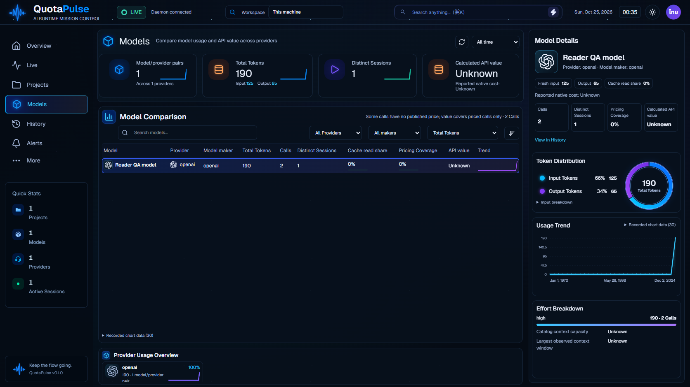

# Stable Codex session identity across incremental reads v1.85.138

Validated causal correction discovered while reviewing the actual reader137 screenshot:150→190 tokens were correct, but the same session became two. The137 token/dedup checks did not establish distinct-session correctness. The retained before image shows the defect; the new regression adds API and actual Models one-session assertions.

When session_meta.id differs from the UUID parsed from the rollout filename, the initial pass uses the header ID. A later delta did not reread that header and reset sid/cwd/gitBranch to null, creating a second fallback session. The cursor now retains these metadata fields beside model/effort. An observed file shrink discards all cached metadata, preventing stale identity/model reuse on a headerless replacement. No filename inference overrides a recorded header ID, and the UI/aggregation does not subtract counts to hide the bug.

Two targeted tests failed before the correction: session identity/project across a closed/reopened database, and stale model on truncation. Both now pass; the full repository passes672 tests (125 daemon,349 web,198 tray). The rebuilt Codex module is byte-equal to the module in the tested reader bundle. Six current real-launcher checks pass on an owned fake home and synthetic source log: default/opt-in/environment/WhatIf behavior,150→190 actual ingestion, one distinct session in API/Models, repeated refresh, enabled restart, retained data when returning to readers-off, source/sentinel preservation and prompt exclusion. All QA processes are stopped. No customer data or credentials were accessed.

[Before: source137 two sessions](../redesign-v1.85.137/evidence/reader-incremental.png)

Legacy cursors lacking the new fields retain the existing filename fallback until authoritative metadata is seen; this is not a repair of already split historical rows. No migration/remapping of old customer facts was performed. The test proves observed truncation behavior, not arbitrary concurrent replacement races or every harness/account provider. Customer-reader acceptance, installed-wrapper opt-in and full visual/native/performance requirements remain open. Current shipped review136 does not include reader opt-in or this correction; a new ZIP is required. The frontend web index and all renderer source are unchanged from135.
